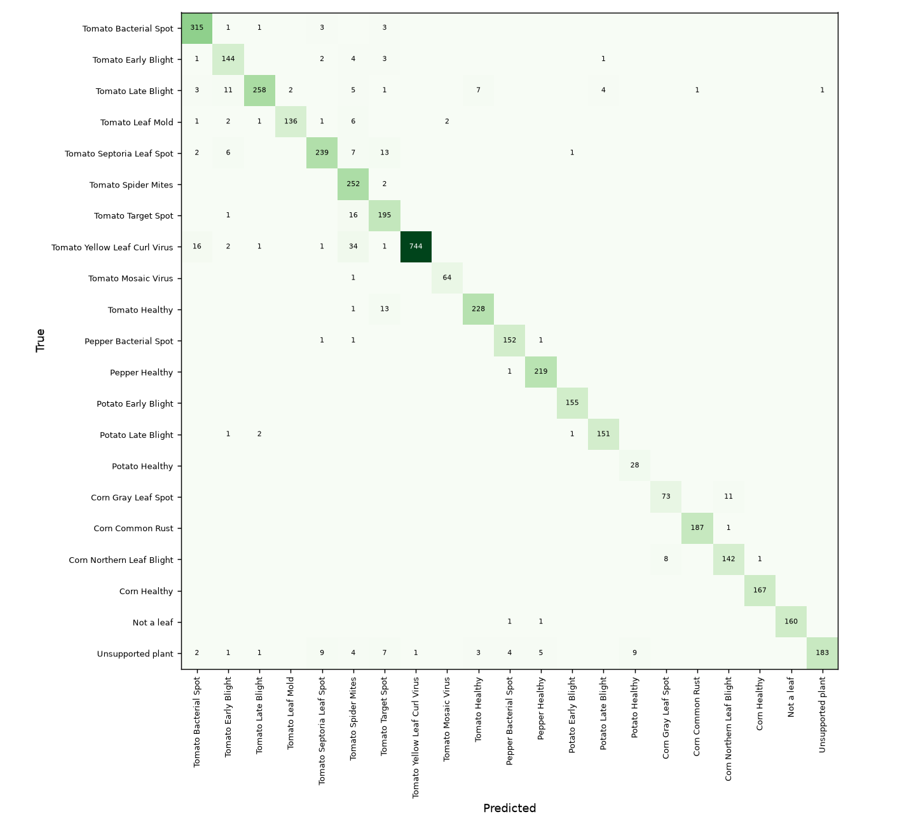

# Sipat - model evaluation

Generated by `scripts/evaluate.py`. Do not edit by hand; re-run the script.

- Dataset: PlantVillage, Mendeley Data doi:10.17632/tywbtsjrjv.1 (without augmentation)
- Model: MobileNetV3Small (ImageNet) + GAP + Dropout 0.25 + Dense softmax, 224x224 input, 10.1 MB
- Split by file-name hash: 13240 train (capped at 700/class), 4383 validation, **4454 test photos never seen in training**
- Training: 6 head epochs + 5 fine-tune epochs, 28.1 min on CPU

## Results on the test set

| Accuracy | Top-3 accuracy | Macro F1 | CPU time / photo (batched) |
|---|---|---|---|
| 95.0% | 99.5% | 0.941 | 6.6 ms |

> Test photos are PlantVillage lab photos (single leaf, plain background). Accuracy on phone photos taken in a field is expected to be lower and has not been measured yet.

## Saying "unsure" instead of guessing

Below the confidence threshold the app answers "not sure - retake the photo".

| Threshold | Photos answered | Accuracy on answered |
|---|---|---|
| 0.0 | 100.0% | 95.0% |
| 0.5 | 98.6% | 95.7% |
| 0.6 | 96.3% | 96.7% |
| 0.7 | 93.7% | 97.6% |
| 0.8 | 90.6% | 98.4% |
| 0.9 | 84.8% | 99.2% |

The app uses **0.7** (lowest threshold reaching 97% accuracy on answered photos).

## Per class

| Class | Precision | Recall | F1 | Test photos |
|---|---|---|---|---|
| Tomato Bacterial Spot | 0.983 | 0.904 | 0.942 | 323 |
| Tomato Early Blight | 0.968 | 0.768 | 0.856 | 155 |
| Tomato Late Blight | 0.905 | 0.942 | 0.923 | 293 |
| Tomato Leaf Mold | 0.948 | 0.980 | 0.964 | 149 |
| Tomato Septoria Leaf Spot | 0.890 | 0.937 | 0.913 | 268 |
| Tomato Spider Mites | 0.932 | 0.921 | 0.927 | 254 |
| Tomato Target Spot | 0.809 | 0.920 | 0.861 | 212 |
| Tomato Yellow Leaf Curl Virus | 0.997 | 0.979 | 0.988 | 799 |
| Tomato Mosaic Virus | 0.984 | 0.969 | 0.977 | 65 |
| Tomato Healthy | 0.920 | 0.996 | 0.956 | 242 |
| Pepper Bacterial Spot | 0.957 | 0.994 | 0.975 | 155 |
| Pepper Healthy | 0.991 | 0.996 | 0.993 | 220 |
| Potato Early Blight | 0.975 | 1.000 | 0.987 | 155 |
| Potato Late Blight | 0.939 | 0.987 | 0.962 | 155 |
| Potato Healthy | 0.700 | 1.000 | 0.824 | 28 |
| Corn Gray Leaf Spot | 0.842 | 0.952 | 0.894 | 84 |
| Corn Common Rust | 1.000 | 1.000 | 1.000 | 188 |
| Corn Northern Leaf Blight | 0.971 | 0.894 | 0.931 | 151 |
| Corn Healthy | 1.000 | 0.994 | 0.997 | 167 |
| Not a leaf | 1.000 | 1.000 | 1.000 | 162 |
| Unsupported plant | 0.970 | 0.834 | 0.897 | 229 |

## Most common mistakes

| Count | True | Predicted as |
|---|---|---|
| 17 | Tomato Early Blight | Tomato Late Blight |
| 16 | Tomato Spider Mites | Tomato Target Spot |
| 15 | Corn Northern Leaf Blight | Corn Gray Leaf Spot |
| 13 | Tomato Bacterial Spot | Tomato Target Spot |
| 12 | Unsupported plant | Potato Healthy |
| 11 | Tomato Bacterial Spot | Tomato Septoria Leaf Spot |
| 9 | Tomato Late Blight | Potato Late Blight |
| 8 | Tomato Target Spot | Tomato Healthy |

