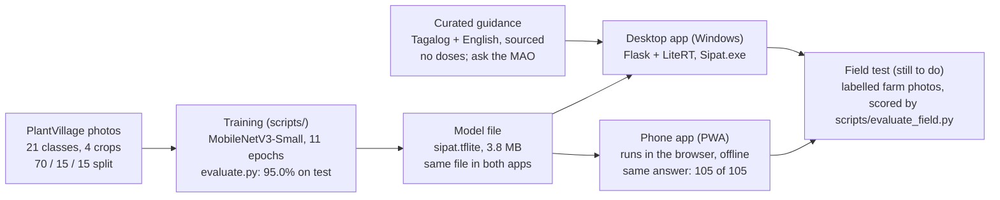

# SIPAT: Smart Image-based Plant Ailment Tracker

*Brief for the thesis group · updated 2026-10-22 · live editable version: https://claude.ai/artifact/K4yRrgPuwpa72XpF5zDn2u (ask James for access)*

SIPAT (Smart Image-based Plant Ailment Tracker) is an offline app that identifies 19 diseases and healthy states of tomato, pepper (sili), potato and corn from a photo of one leaf, then gives Tagalog and English treatment guidance. It runs on a Windows PC and on a phone, with no internet needed. This page is the starting brief for writing the paper.

**About the name.** SIPAT is both an acronym and a Filipino word: *sipat* means to look at something closely, the way a farmer inspects a leaf. Each part of the acronym names something the system does: **Smart** (a trained neural network), **Image-based** (one photo of a leaf is the only input), **Plant Ailment** (leaf diseases of tomato, pepper, potato and corn), **Tracker** (plots, follow-up scans and recheck reminders follow a disease over time). In the paper, write "SIPAT" in capitals the first time with the full name in brackets, then "SIPAT" after that.

## At a glance

The model is trained once on the laptop; the resulting 3.8 MB file runs unchanged in both apps, which is why they give the same answers. The field test closes the loop by measuring the model on real farm photos.

## The problem and what SIPAT does

Smallholder farmers often notice a leaf disease late, and an agricultural technician is not always nearby. SIPAT lets a farmer photograph one leaf and get, in seconds and offline, the likely disease, how sure the AI is, and what to do next. It always points to the Municipal Agriculture Office (MAO) for doses and confirmation.

**General objective:** build and evaluate an offline, bilingual mobile and desktop system that detects common leaf diseases of tomato, pepper, potato and corn from photos.

**Specific objectives (suggested wording):**

1. Train a lightweight image classifier (MobileNetV3-Small) on PlantVillage and measure its accuracy on photos it never saw.
2. Make the system refuse to guess when it is unsure, when there is no leaf, or when the plant is not covered.
3. Show which part of the leaf the AI based its answer on (heat map), so users can judge the answer.
4. Give curated, sourced treatment guidance in Tagalog and English, with no invented doses.
5. Run fully offline, on a PC and on a phone, with the same answers on both.
6. Collect labelled field photos to measure accuracy in real farm conditions.

**Scope:** 4 crops, 19 disease and healthy classes, plus "not a leaf" and "other plant" (21 outputs). **Out of scope for now:** rice (PlantVillage has no rice photos), pests that do not show on leaves, dose recommendations.

## Features

Both versions run the same trained model file and the same decision rule, so they give the same diagnosis for the same photo.

| Feature | What it does | Desktop (Windows) | Phone |
| --- | --- | --- | --- |
| Leaf scan | Camera or gallery photo, diagnosis in under a second | Yes | Yes |
| Top 3 guesses | Shows the 3 most likely classes with their confidence | Yes | Yes |
| Refuses to guess | "Not sure" below 70% confidence; "no leaf"; "unsupported plant" | Yes | Yes |
| Heat map | Colours the part of the leaf the AI used (class activation map) | Yes | Yes |
| Treatment guide | Curated Tagalog + English steps with sources, no doses | Yes | Yes |
| Adviser | Answers follow-up questions from the curated text only | Yes, plus an optional local AI (Ollama) for other questions | Curated answers only |
| Plots and follow-ups | Group scans by field; re-scan later and see better / same / worse | Yes | Yes |
| Recheck reminders | "Check again on" date, shown on the home screen when due | Yes | Yes |
| Disease library | Every covered disease with a sample photo and its test accuracy | Yes | Yes |
| Field labels | "Was this right?" builds a labelled set of real farm photos | Yes | Yes |
| Field set export | Zip of labelled photos for scripts/evaluate_field.py | Yes | Yes |
| MAO printout | A4 sheet of a diagnosis to bring to the agriculture office | Yes | No |
| Statistics | Weekly scans, status mix, field accuracy | Yes | No |
| Works offline | No internet after setup; photos never uploaded | Yes | Yes, after opening once from an HTTPS link |
| Dashboard | Home screen summary: healthy vs sick vs unsure, scans per week, most common diseases, latest result per plot, rechecks due | Yes | Yes |
| Language | Everyday Taglish on screens and in the guidance; technical words (spray, fungicide, MAO) kept in English | Yes | Yes |

The phone version is an installable web app (PWA). It needs no app store: open the link once, choose "Add to Home screen", and it works with no signal.

## How the AI works

SIPAT uses transfer learning: a small network pre-trained on ImageNet, re-trained on labelled leaf photos.

| Part | Detail |
| --- | --- |
| Dataset | PlantVillage (Mendeley Data, doi:10.17632/tywbtsjrjv.1), single leaves on a plain background |
| Classes | 19 crop classes (tomato 10, pepper 2, potato 3, corn 4) + "Background without leaves" + "Other plant" (apple, grape, soybean and other PlantVillage leaves pooled) = 21 |
| Split | 70% train / 15% validation / 15% test, assigned by a hash of each file name so it never changes; train capped at 700 photos per class |
| Photo counts | 13,240 train, 4,383 validation, 4,454 test |
| Model | MobileNetV3-Small (ImageNet weights) + global average pooling + dropout 0.25 + dense softmax; input 224 x 224 RGB |
| Training | 6 epochs with the base frozen, then 5 epochs fine-tuning the last 40 layers; 28 minutes on a laptop CPU (TensorFlow 2.22) |
| Deployment | Exported to TensorFlow Lite (3.8 MB, float32). Desktop runs it with LiteRT; the phone runs the same file in the browser through TensorFlow.js tflite (WebAssembly) |

**The confidence rule.** The model outputs 21 probabilities. If the top one is below 0.70, SIPAT answers "not sure, retake the photo" instead of guessing. If the top class is "Background without leaves" or "Other plant" at 0.70 or more, it says so instead of naming a disease. The 0.70 cut-off was picked on the test-set threshold sweep in docs/EVALUATION.md, not guessed.

**The heat map.** Because the network ends in global average pooling and one dense layer, the evidence for a class can be mapped back onto the photo: the class's dense-layer weights times the last feature map (7 x 7 x 576). This is Class Activation Mapping (Zhou et al., 2016); for this architecture it equals Grad-CAM (Selvaraju et al., 2017). If the hot area is off the leaf, the user knows to distrust the answer.

**The adviser.** Follow-up questions (dose, spraying, organic options, prevention, harvest, when to get help) are matched by English and Tagalog keywords and answered with the curated text word for word. A dose question always gets "follow the FPA-registered label and ask your MAO". This design came from testing: a 3B local language model invented a dose ("500 gramo") despite instructions, so the model is now only a guarded fallback on the desktop, and absent on the phone.

## Measured results

On 4,454 test photos the model never saw, SIPAT is 95.0% accurate; at the 0.70 cut-off it answers 93.7% of photos and is right on 97.6% of those. Every number here was produced by a script in the repo; quote only these, and say they are lab photos.

| Measure | Value | Produced by |
| --- | --- | --- |
| Accuracy (21 classes) | 95.0% | scripts/evaluate.py -> docs/EVALUATION.md |
| Correct answer in top 3 | 99.5% | same |
| Macro F1 | 0.941 | same |
| At 0.70 cut-off: photos answered / accuracy on those | 93.7% / 97.6% | same (threshold sweep) |
| Weakest class by recall | Tomato Early Blight 0.77 (17 of 155 called Late Blight) | same (confusion matrix) |
| Weakest class by precision | Potato Healthy 0.70 (only 28 test photos) | same |
| Model size / speed | 3.8 MB TFLite; 6.6 ms per photo batched on a laptop CPU | scripts/export_tflite.py, evaluate.py |
| Phone vs desktop agreement | 105 / 105 same class and status; largest probability gap 0.0000024 | scripts/pwa_parity.py + pwa/parity.html (2026-10-22) |
| Automated tests | 67 passing | python -m pytest tests |

The cut-off trades coverage for accuracy: 0.50 answers 98.6% at 95.7%, 0.70 answers 93.7% at 97.6%, 0.90 answers 84.8% at 99.2%. The full sweep and the confusion matrix are in docs/EVALUATION.md; use them as the paper's figures.

**Not yet measured:** accuracy on real phone photos taken in a field. This is the most important missing number (see the checklist below).

## Limitations and what the paper must not claim

The panel will check every number against the code, so the paper claims only what was measured.

- **Lab photos, not field photos.** PlantVillage leaves are single, centred, on a plain background. Real phone photos (several leaves, soil, shadows, blur) will score lower. Do not present 95.0% as field accuracy.
- **No rice.** PlantVillage has no rice photos. Rice needs a new dataset and retraining (TRAINING.md explains how).
- **Lookalike diseases.** Tomato Early Blight vs Late Blight and Spider Mites vs Target Spot are the main confusions; the top-3 list and the heat map exist for this.
- **Treatment text is general extension guidance** (UC IPM, Cornell, Penn State, CIP, CIMMYT), not a Department of Agriculture sign-off, and it never gives doses.
- **Never write:** a pilot with farmers, savings in pesticide, or any accuracy figure that does not come from the scripts. An earlier version of the README had invented numbers like these (94.3%, a 50-farmer pilot, 23% savings); they were removed because no such test happened.
- **Phone speed** was measured on a laptop browser (about 40-80 ms per photo). Run pwa/parity.html on a real phone before quoting phone timings.

## Paper outline

A standard five-chapter structure; each chapter can start from the repo file listed (all under tanim_guard/). Add a Writer column if you want to split the work.

| Chapter | What goes in it | Start from |
| --- | --- | --- |
| 1 Introduction | Background (leaf diseases, access to technicians), problem statement, objectives, scope and limits, significance | This page: "The problem" and "Limitations" |
| 2 Review of related literature | PlantVillage studies, CNNs and transfer learning, MobileNetV3, on-device AI, CAM / Grad-CAM, existing plant-disease apps | Sources section below; Zhou 2016, Selvaraju 2017, Howard 2019 papers |
| 3 Methodology | Dataset and split, model and training, threshold choice, heat map, treatment curation rules, adviser design, system architecture, phone app | TRAINING.md, scripts/tg_data.py (split), scripts/train_model.py, app/ml/inference.py, app/ml/treatment_data.py (header lists the rules), pwa/README.md |
| 4 Results and discussion | Accuracy, top-3, macro F1, per-class table, confusion matrix, threshold sweep, phone vs desktop parity, field results once collected | docs/EVALUATION.md, app/ml/model/evaluation_report.json, pwa/README.md, docs/FIELD_EVALUATION.md (after field test) |
| 5 Conclusion and recommendations | What was achieved per objective; rice, more field data, quantised model, more crops | This page: "Limitations" and "Before the defense" |
| Appendices | Screenshots (desktop and phone), user guide, test list, treatment table | README.md, SETUP.md, tests/ |

## Before the defense

- [ ] Collect real field photos: each of us scans leaves on the phone app and taps "Was this right?" (best if the MAO confirms the label). Aim for 30+ photos per crop class we can find.
- [ ] Export the field set from the phone (About -> Field set .zip) and run `python scripts/evaluate_field.py` on the laptop; put the docs/FIELD_EVALUATION.md numbers in Chapter 4.
- [ ] Host the phone app on an HTTPS link (e.g. GitHub Pages) so panelists can install it on their own phones.
- [ ] Run pwa/parity.html on at least one real Android phone and record the time per photo.
- [ ] Decide on rice: get a labelled rice leaf dataset, retrain (TRAINING.md), re-run the evaluation.
- [ ] Take screenshots of every screen (desktop and phone) for the appendix.
- [ ] Have the MAO or an agriculture faculty member review the treatment text.

## Sources

- Hughes, D. P., and Salathe, M. (2015). An open access repository of images on plant health. arXiv:1511.08060. PlantVillage dataset as used: Mendeley Data, doi:10.17632/tywbtsjrjv.1.
- Howard, A., et al. (2019). Searching for MobileNetV3. ICCV 2019. arXiv:1905.02244.
- Zhou, B., et al. (2016). Learning Deep Features for Discriminative Localization (CAM). CVPR 2016.
- Selvaraju, R. R., et al. (2017). Grad-CAM: Visual Explanations from Deep Networks. ICCV 2017.
- Treatment references (listed per disease in app/ml/treatment_data.py): UC IPM Pest Management Guidelines; Cornell Vegetable MD Online; Penn State Extension; International Potato Center (CIP); CIMMYT Maize Doctor. Use of pesticides follows Fertilizer and Pesticide Authority (FPA) registration and labels.

Citations above are from memory of the standard references; check each against the actual paper before it goes into the bibliography.
